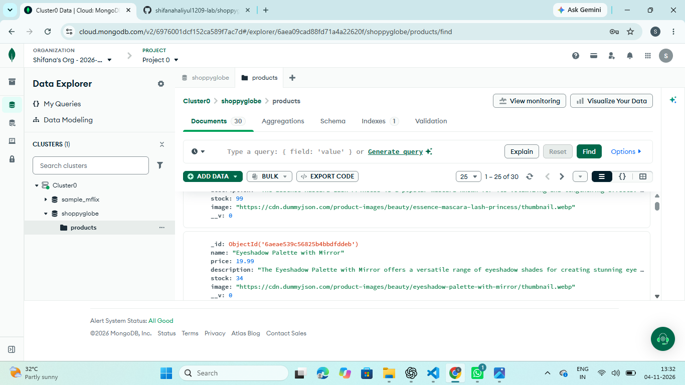
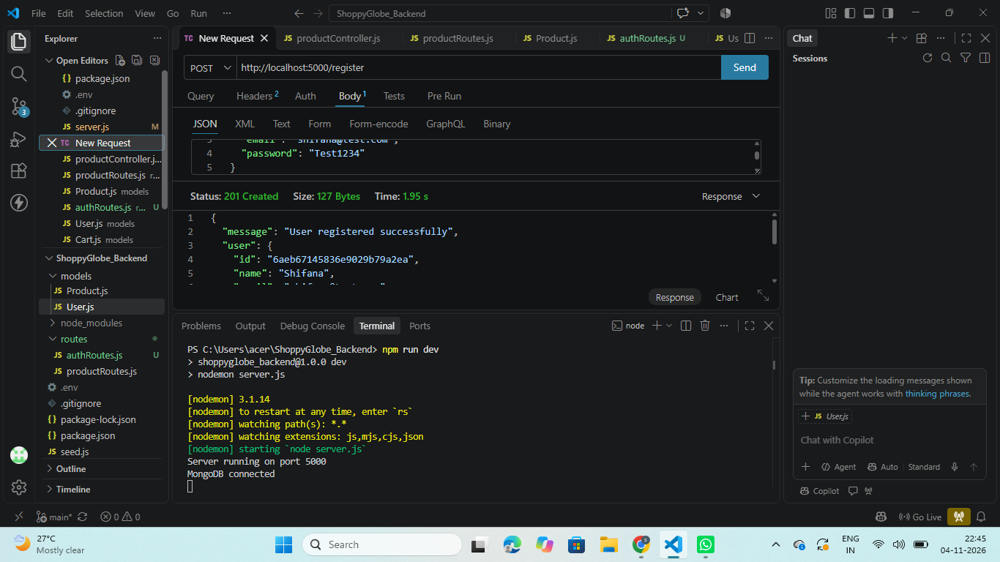
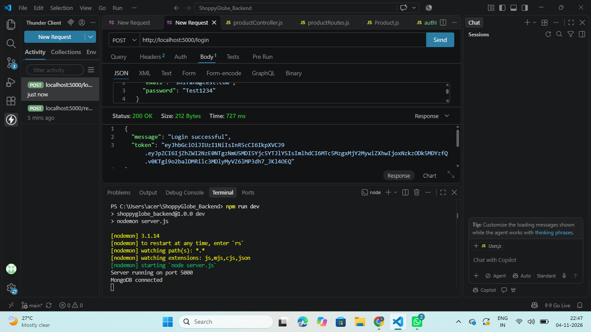
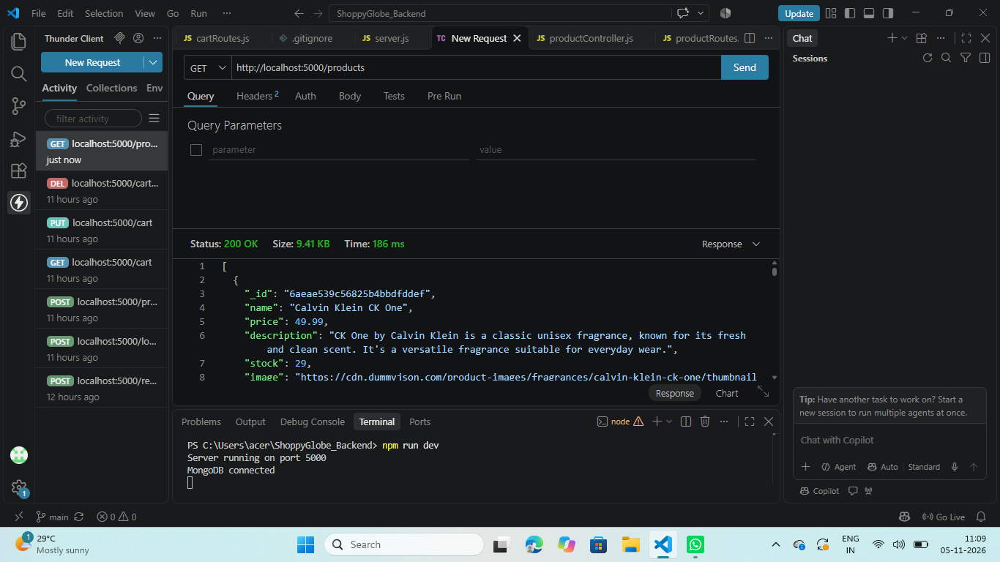
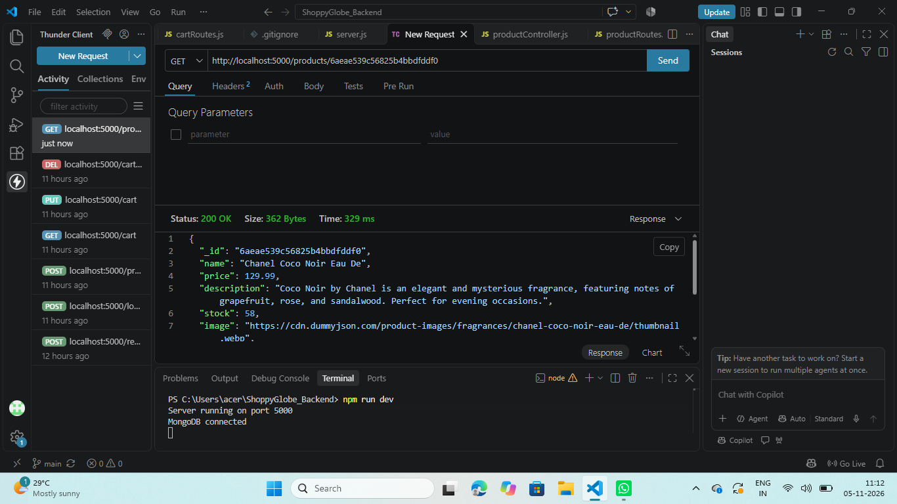
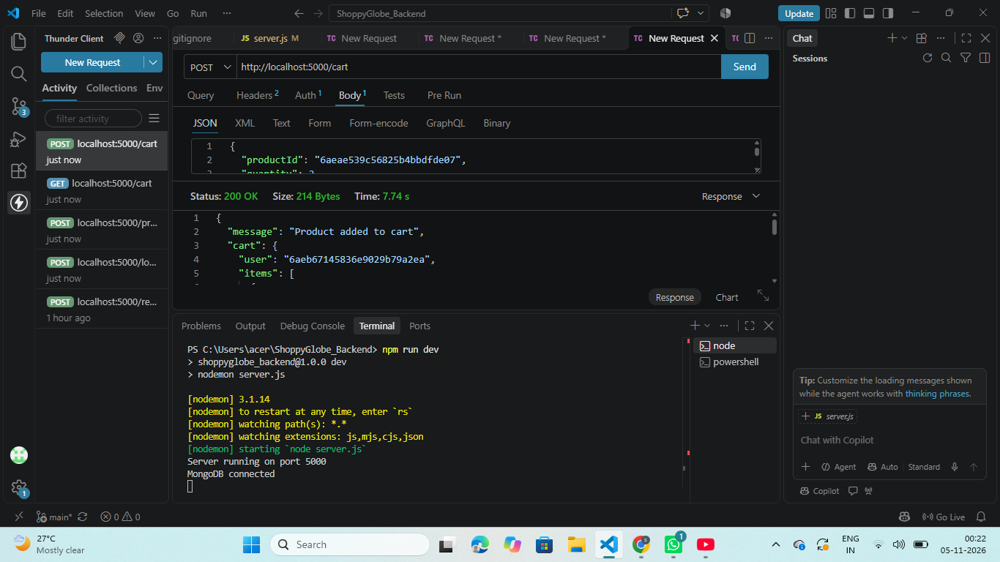
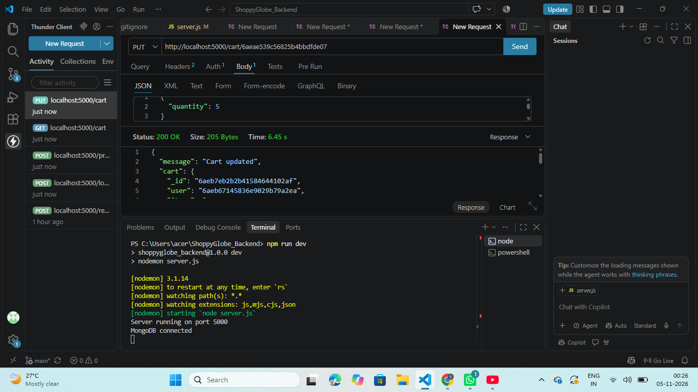
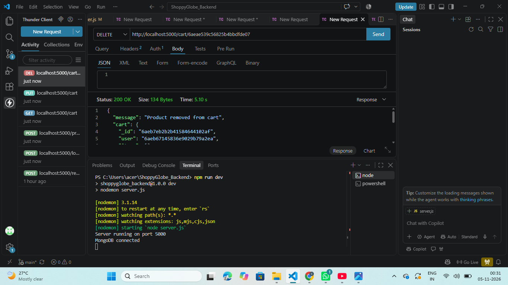
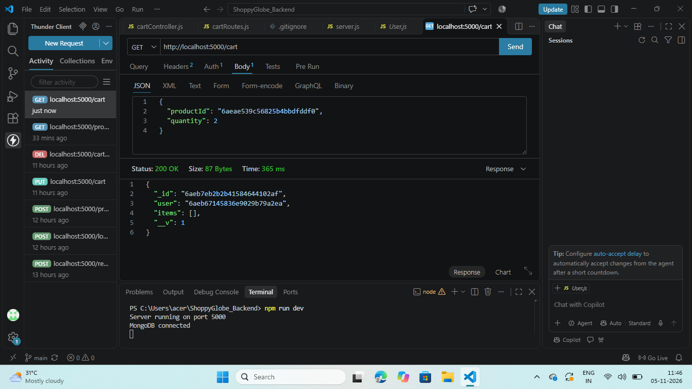
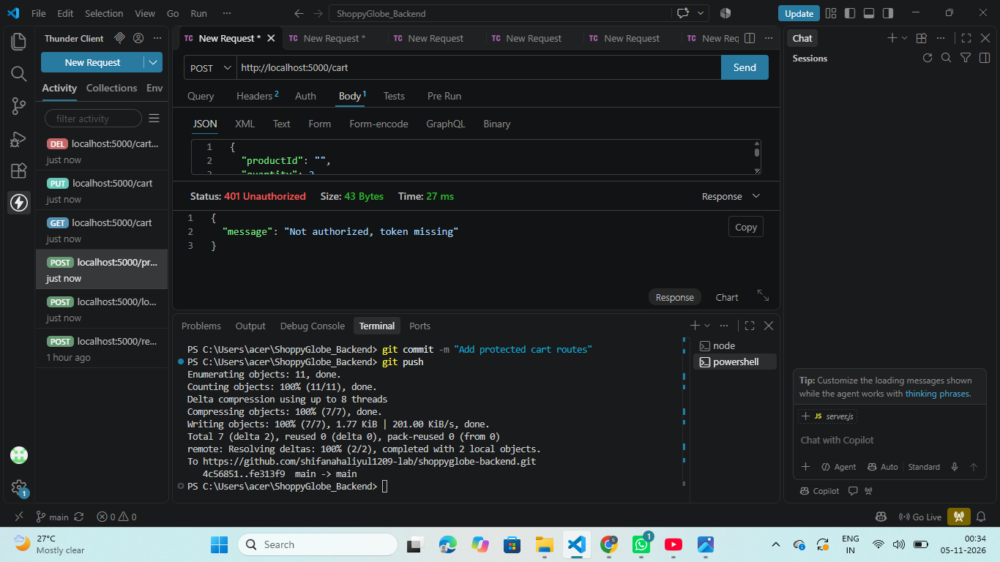

# ShoppyGlobe Backend

Backend APIs for the ShoppyGlobe e-commerce application (Amazon-inspired), built with Node.js, Express, MongoDB and JWT authentication.

**GitHub Repository:** https://github.com/shifanahaliyul1209-lab/shoppyglobe-backend

## Tech Stack
Node.js, Express.js, MongoDB (Mongoose), JSON Web Tokens (JWT), bcryptjs, dotenv, cors

## Features
- Product APIs: list all products and get a single product by ID
- User registration and login with JWT authentication
- Protected cart APIs: add a product, update its quantity, remove it and view the cart
- Input validation and error handling on all routes
- Passwords stored as bcrypt hashes
- MongoDB collections: `products`, `users`, `carts`

## Folder Structure
- `config/db.js`: MongoDB connection
- `models/`: Product, User and Cart schemas
- `controllers/`: product, auth and cart logic
- `routes/`: product, auth and cart routes
- `middleware/authMiddleware.js`: JWT protection for cart routes
- `screenshots/`: MongoDB and API testing screenshots
- `seed.js`: loads 30 sample products into MongoDB
- `server.js`: app entry point

## Setup and Run
1. Clone the repository and run `npm install`
2. Create a `.env` file in the main folder:
   ```
   PORT=5000
   MONGO_URI=<your MongoDB Atlas connection string>
   JWT_SECRET=<any long random text>
   ```
3. Load the sample products once: `node seed.js`
4. Start the server: `npm run dev`
5. The API runs at `http://localhost:5000`

## API Routes

| Method | Route | Description | Auth |
|---|---|---|---|
| POST | `/register` | Register a new user | No |
| POST | `/login` | Login and receive a JWT token | No |
| GET | `/products` | Get all products | No |
| GET | `/products/:id` | Get one product by ID | No |
| GET | `/cart` | View the logged-in user's cart | Yes |
| POST | `/cart` | Add a product to the cart | Yes |
| PUT | `/cart/:productId` | Update the quantity of a product | Yes |
| DELETE | `/cart/:productId` | Remove a product from the cart | Yes |

Protected routes need the header `Authorization: Bearer <token>`.

### Request body examples

**Register**
```json
{ "name": "Shifana", "email": "shifana@test.com", "password": "Test1234" }
```

**Login**
```json
{ "email": "shifana@test.com", "password": "Test1234" }
```

**Add to cart**
```json
{ "productId": "<product _id>", "quantity": 2 }
```

**Update quantity**
```json
{ "quantity": 5 }
```

## Error Handling and Validation
- Invalid product IDs return `400`, and products that do not exist return `404`
- Quantity must be a whole number of at least 1, and stock is checked before adding
- Duplicate emails are rejected on registration
- Wrong email or password returns `401`
- Missing or invalid tokens return `401`
- Unexpected errors return `500` with a message

## MongoDB Database Screenshot





## API Testing Screenshots (Thunder Client)

### Register user





### Login user





### Get all products





### Get product by ID





### Add product to cart





### Update cart quantity





### Remove product from cart





### View cart





### Cart without a token (401)


